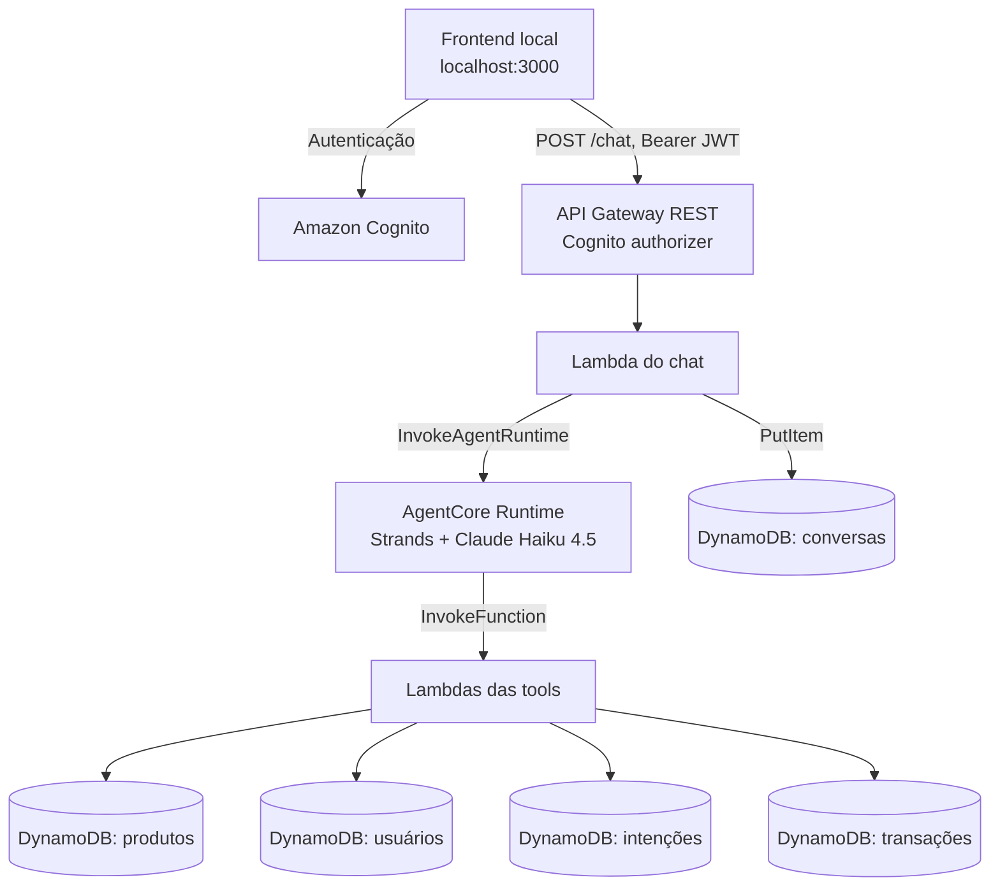

# Desafio 1 — Alan Lorenz

## Status da entrega

A infraestrutura AWS e o frontend local estão implementados para execução em
`us-east-1`. Builds, testes locais e síntese CDK foram executados; **a stack
ainda não foi publicada na AWS**. Portanto, login real, compras integradas com
Bedrock e as evidências exigidas ainda precisam ser validados após um deploy
autorizado.

## Confronto com o PDF: estado e pendências

### Implementado em código

- Frontend Next.js executado em `http://localhost:3000`, configurado por
  `.env.local` para usar Cognito e a API implantados na AWS. A stack não cria
  hospedagem S3/CloudFront para o frontend.
- Cognito sem auto cadastro, com convite administrativo; a API Gateway valida
  o token e a Lambda obtém o usuário do `sub`.
- CORS da API limitado à origem local `http://localhost:3000`.
- `POST /chat` transmite a resposta; o histórico completo do turno é enviado ao
  agente Strands no AgentCore Runtime, usando o Claude Haiku do Bedrock.
- As três ferramentas rodam em Lambdas. Usuários, conversas, intenções e
  transações usam DynamoDB; compra e limite são atualizados com condições para
  evitar duplicidade.
- A stack CDK cria os recursos de backend e autenticação. O frontend tem
  instruções de execução em [`frontend/README.md`](./frontend/README.md).
- A validação local de build, testes e síntese passou.

### Pendências antes da entrega

1. **Revalidar o menor privilégio antes do deploy:** o acesso ao modelo agora
   enumera os ARNs de destino necessários ao perfil US do Claude Haiku
   (`us-east-1`, `us-east-2` e `us-west-2`), em vez de usar um curinga regional.
   Ainda há padrões curinga delimitados nas permissões operacionais geradas pelo
   AgentCore para logs, identidade e invocação do runtime. O PDF proíbe
   `Action: "*"` com `Resource: "*"` e políticas gerenciadas amplas; os testes
   verificam que não haja recurso global `"*"`. Confira a síntese e valide o
   comportamento do runtime após o deploy.
2. **Preparar a conta AWS:** configurar um alerta no AWS Budgets antes do
   primeiro deploy e confirmar no console o acesso ao modelo Bedrock em
   `us-east-1`. Nenhum dos dois foi confirmado.
3. **Resolver a divergência de estrutura:** este repositório e o README da raiz
   pedem `Desafio-1/<nome>/`, enquanto o PDF cita `fellows/<nome>/`. A pasta
   atual segue o README da raiz; confirme com a coordenação qual instrução vale
   antes de abrir o PR.
4. **Fazer o deploy autorizado em `us-east-1`**, inserir o catálogo inicial e
   criar por convite os usuários de teste e o usuário do instrutor.
5. **Validar na AWS e anexar as seis evidências** listadas abaixo. O PR ainda
   não foi aberto; revise também o histórico de commits antes de criá-lo e
   mantenha a aplicação disponível até a correção.

### Limite atual do histórico de conversas

As mensagens são gravadas no DynamoDB e o frontend envia o histórico completo
em cada turno, mas não existe endpoint para buscar conversas já salvas e
restaurá-las após recarregar a página. O PDF cita `GET /conversas` como exemplo,
não como rota obrigatória; implemente recuperação se a entrega precisar
retomar conversas anteriores.

## Arquitetura implementada



O frontend é executado localmente; Cognito, API, agente, ferramentas e dados
ficam na AWS. O endpoint de chat exige autenticação Cognito. O `userId` é sempre
o `sub` validado no token, nunca o valor enviado pelo cliente ou pelo modelo. A
API transmite respostas em streaming.

### Modelo

`us.anthropic.claude-haiku-4-5-20251001-v1:0` (perfil de inferência do Amazon
Bedrock). A primeira chamada real pode exigir habilitação/inscrição do modelo e
gerar custos; isso ainda não foi testado nesta conta.

### Modelagem DynamoDB

| Tabela | Chave de partição | Chave de ordenação | Conteúdo |
|---|---|---|---|
| `AlanLorenz-Produtos` | `id` | — | Catálogo, preço em centavos, estoque e categoria |
| `AlanLorenz-Usuarios` | `userId` (`sub` Cognito) | — | Limite total e saldo restante em centavos; perfil criado no primeiro acesso autenticado ao chat com limite inicial de R$ 1.000,00 (100000 centavos) |
| `AlanLorenz-Conversas` | `userId` (`sub` Cognito) | `messageKey` | Mensagens e eventos de ferramentas, ordenados por conversa/turno |
| `AlanLorenz-Intencoes` | `intentionId` | — | Usuário, conversa, total calculado, status e expiração |
| `AlanLorenz-Transacoes` | `intentionId` | — | Transação simulada; uma por intenção |

As tabelas usam cobrança sob demanda com limite de throughput configurado para
5 unidades de leitura e escrita por segundo; isso **não** é um teto de gasto
mensal. Não há TTL nem índices secundários. A compra atualiza intenção, limite,
estoque e transação em uma única escrita condicional transacional.

A Lambda do chat grava a mensagem recebida, a resposta do agente e os eventos
concluídos das ferramentas. A chave determinística por conversa e turno evita
duplicar os mesmos itens em retentativas. A role do chat não tem leitura da
tabela de conversas.

## Revisão de permissões IAM

As roles de aplicação são separadas por função. As permissões DynamoDB são
limitadas aos ARNs das tabelas indicadas; nenhuma role de aplicação recebe
`AdministratorAccess`.

| Role | Permissões principais |
|---|---|
| `AlanLorenz-ChatHandler` | `logs:CreateLogStream`/`logs:PutLogEvents` no próprio log group; `bedrock-agentcore:InvokeAgentRuntime` no runtime; `dynamodb:PutItem` em `AlanLorenz-Conversas`; `dynamodb:GetItem`/`dynamodb:PutItem` em `AlanLorenz-Usuarios` para provisionar idempotentemente o perfil no primeiro acesso autenticado (limite inicial de 100000 centavos) |
| `AlanLorenz-ListCatalog` | `dynamodb:Scan` somente em `AlanLorenz-Produtos`; escrita no próprio log group |
| `AlanLorenz-RegisterIntention` | `GetItem` em Produtos; `GetItem`/`PutItem` em Usuários (garantia idempotente do perfil, se necessário); `PutItem` em Intenções; escrita no próprio log group |
| `AlanLorenz-RealizarCompra` | `GetItem`/`UpdateItem`/`TransactWriteItems` apenas nas tabelas necessárias (Intenções e Produtos); `GetItem`/`TransactWriteItems` em Usuários; `TransactWriteItems` em Transações; escrita no próprio log group |
| `ChatAgentRuntimeExecutionRole` | Invoca somente as três Lambdas das ferramentas; acessa o perfil Claude indicado e o foundation model correspondente, condicionado ao perfil de inferência; permissões de execução/telemetria do AgentCore |

As permissões globais `Resource: "*"` geradas pelo CDK para X-Ray/métricas do
AgentCore foram removidas; tracing e publicação dessas métricas não são usados
pela aplicação. Não há role nem recursos para publicar o frontend. O acesso
ao Claude Haiku usa ARNs exatos do perfil de inferência e dos três destinos
regionais desse perfil. Os padrões `*` restantes vêm de permissões operacionais
do AgentCore, delimitadas à região/conta e a logs, streams, identidade ou
invocação do runtime; não são grants globais de dados. Um teste CDK falha se
voltar a surgir `Resource: "*"`. Os três destinos do perfil US e os ARNs de
modelo correspondentes seguem a [disponibilidade regional oficial do Claude
Haiku 4.5](https://docs.aws.amazon.com/bedrock/latest/userguide/model-card-anthropic-claude-haiku-4-5.html)
e os [requisitos IAM para perfis de inferência](https://docs.aws.amazon.com/bedrock/latest/userguide/inference-profiles-prereq.html).

O role de deploy usado por quem executa CDK/bootstrap é separado das roles em
runtime; use credenciais AWS autorizadas e não armazene chaves no repositório.

## Deploy e provisionamento

Pré-requisitos: Node.js/npm, Python 3.13, `uv`, AWS CLI configurada e
autorização para criar recursos. Os comandos abaixo são PowerShell. A partir
da pasta `infra/`:

```powershell
npm ci
npm run test -- --runInBand
npm run test:agent
npm run synth
```

`synth` prepara as dependências do backend, empacota o agente e sintetiza a
stack; não faz deploy nem chama o modelo. Para validar o frontend localmente,
use `npm run check` na pasta `frontend/`. Após revisar o template e receber
autorização:

```powershell
npm run deploy
```

O comando prepara o bootstrap CDK em `us-east-1` se necessário e publica a
stack `AlanLorenzInfraStack`, sem publicar o frontend. Anote os outputs
`UserPoolId`, `UserPoolClientId` e `ChatApiEndpoint`; use-os para configurar e
executar o frontend conforme [`frontend/README.md`](./frontend/README.md). Para
validar as ferramentas localmente, na pasta `tools/`:

```powershell
npm ci
npm run check
```

Após o deploy autorizado, crie administrativamente os usuários do app e do
instrutor (o cadastro público está desativado). Substitua os valores abaixo
pelos outputs e e-mail fornecidos pela coordenação:

```powershell
$poolId = '<UserPoolId>'
$email = '<email-do-usuario-ou-instrutor>'
aws cognito-idp admin-create-user `
  --user-pool-id $poolId `
  --username $email `
  --user-attributes Name=email,Value=$email Name=email_verified,Value=true `
  --desired-delivery-mediums EMAIL `
  --region us-east-1
```

Para inserir o catálogo inicial sem sobrescrever itens existentes, na pasta
`tools/`:

```powershell
$env:PRODUCTS_TABLE = 'AlanLorenz-Produtos'
npm run seed:catalog
```

O provisionamento de usuários e o seed gravam na conta AWS. Não os execute
sem autorização.

## Evidências de validação

**Ainda não há evidências reais:** a stack não foi implantada e não se deve
substituir os itens abaixo por resultados de mocks/testes locais. Após o deploy,
anexe capturas ou registros anonimizados em uma pasta `evidencias/` e atualize
esta tabela. Nunca inclua tokens JWT, senhas temporárias ou dados pessoais.

| Cenário exigido | Estado | Evidência |
|---|---|---|
| Login Cognito | Pendente de deploy/teste real | A anexar |
| Resposta `401` sem token válido | Pendente de deploy/teste real | A anexar |
| Compra simulada com cartão | Pendente de deploy/teste real | A anexar |
| Compra simulada com Pix | Pendente de deploy/teste real | A anexar |
| Compra recusada por limite excedido | Pendente de deploy/teste real | A anexar |
| `intencao_id` inválido/pertencente a outro usuário | Pendente de deploy/teste real | A anexar |

Mantenha a aplicação e o usuário do instrutor disponíveis até a correção,
conforme o enunciado.

## Remoção da infraestrutura

Depois da correção/avaliação e com autorização para remover, na pasta `infra/`:

A stack define a remoção das tabelas e do User Pool:

```powershell
npm run cdk -- destroy AlanLorenzInfraStack
```

Faça
backup dos dados necessários antes. A remoção apaga conversas, usuários
DynamoDB, intenções, transações e catálogo. O bootstrap CDK da conta/região é
compartilhado e não é removido por esse comando.

## Pastas

- [`frontend/`](./frontend/) — interface local e autenticação Cognito.
- [`api/`](./api/) — Lambda de chat e persistência de conversas.
- [`agent/`](./agent/) — agente Strands executado no AgentCore.
- [`tools/`](./tools/) — ferramentas de catálogo, intenção e compra.
- [`infra/`](./infra/) — stack AWS CDK e validações de infraestrutura.
