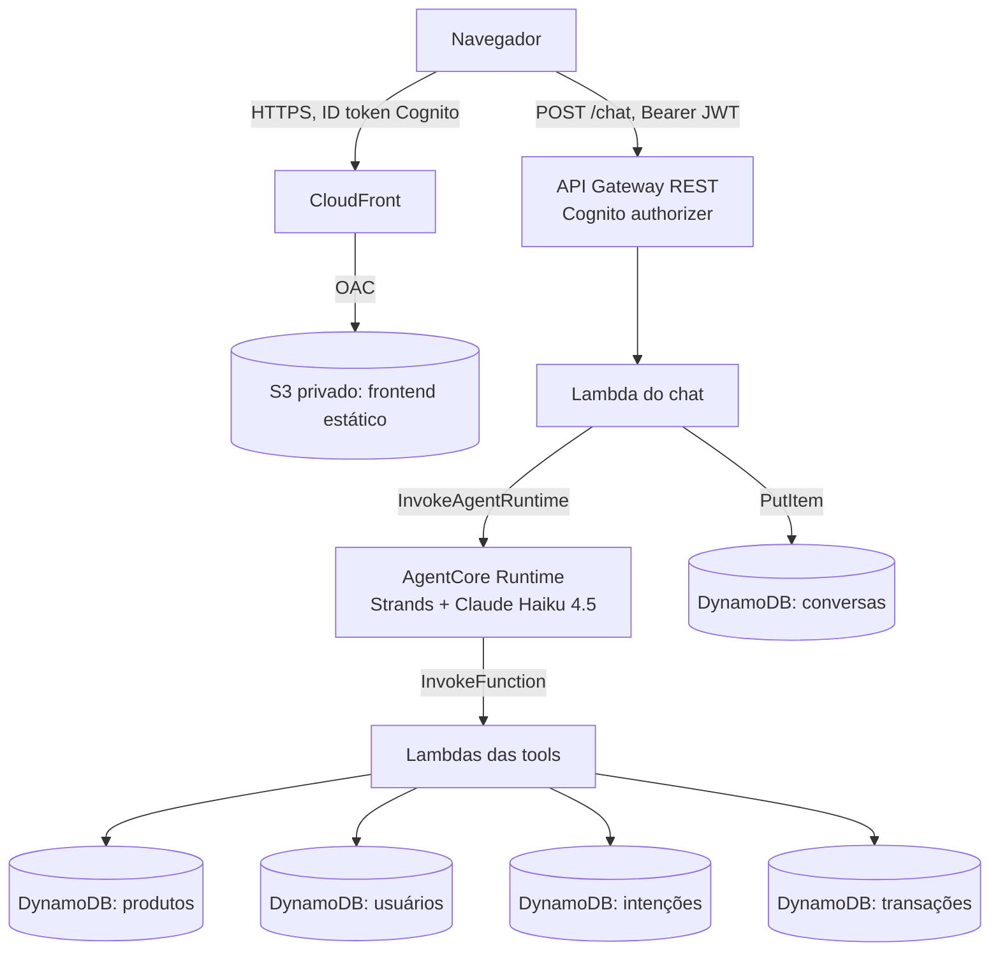

# Desafio 1 — Alan Lorenz

## Status da entrega

A infraestrutura e a aplicação estão implementadas para deploy em `us-east-1`.
Builds, testes locais e síntese CDK foram executados; **a stack ainda não foi
publicada na AWS**. Portanto, login real, compras integradas com Bedrock e as
evidências exigidas pelo desafio ainda precisam ser validados após um deploy
autorizado.

## Arquitetura implementada



O bucket do frontend bloqueia acesso público e só é servido por CloudFront via
Origin Access Control. O endpoint de chat exige autenticação Cognito. O `userId`
é sempre o `sub` validado no token, nunca o valor enviado pelo cliente ou pelo
modelo. O frontend é uma exportação estática Next.js; a API transmite respostas
em streaming.

### Modelo

`us.anthropic.claude-haiku-4-5-20251001-v1:0` (perfil de inferência do Amazon
Bedrock). A primeira chamada real pode exigir habilitação/inscrição do modelo e
gerar custos; isso ainda não foi testado nesta conta.

### Modelagem DynamoDB

| Tabela | Chave de partição | Chave de ordenação | Conteúdo |
|---|---|---|---|
| `AlanLorenz-Produtos` | `id` | — | Catálogo, preço em centavos, estoque e categoria |
| `AlanLorenz-Usuarios` | `userId` (`sub` Cognito) | — | Limite total e saldo restante em centavos |
| `AlanLorenz-Conversas` | `userId` (`sub` Cognito) | `messageKey` | Mensagens e eventos de ferramentas, ordenados por conversa/turno |
| `AlanLorenz-Intencoes` | `intentionId` | — | Usuário, conversa, total calculado, status e expiração |
| `AlanLorenz-Transacoes` | `intentionId` | — | Transação simulada; uma por intenção |

As tabelas usam cobrança sob demanda com limite de throughput configurado para
5 unidades de leitura e escrita por segundo; isso **não** é um teto de gasto
mensal. Não há TTL nem índices secundários. A compra atualiza intenção, limite,
estoque e transação em uma única escrita condicional transacional.

A Lambda do chat grava a mensagem recebida, a resposta do agente e os eventos
concluídos das ferramentas. A chave determinística por conversa e turno evita
duplicar os mesmos itens em retentativas. A role do chat não tem leitura da
tabela de conversas.

## Revisão de permissões IAM

As roles de aplicação são separadas por função. As permissões DynamoDB são
limitadas aos ARNs das tabelas indicadas; nenhuma role de aplicação recebe
`AdministratorAccess`.

| Role | Permissões principais |
|---|---|
| `AlanLorenz-ChatHandler` | `logs:CreateLogStream`/`logs:PutLogEvents` no próprio log group; `bedrock-agentcore:InvokeAgentRuntime` no runtime; `dynamodb:PutItem` somente em `AlanLorenz-Conversas` |
| `AlanLorenz-ListCatalog` | `dynamodb:Scan` somente em `AlanLorenz-Produtos`; escrita no próprio log group |
| `AlanLorenz-RegisterIntention` | `GetItem` em Produtos; `GetItem`/`PutItem` em Usuários; `PutItem` em Intenções; escrita no próprio log group |
| `AlanLorenz-RealizarCompra` | `GetItem`/`UpdateItem`/`TransactWriteItems` apenas nas tabelas necessárias (Intenções e Produtos); `GetItem`/`TransactWriteItems` em Usuários; `TransactWriteItems` em Transações; escrita no próprio log group |
| `ChatAgentRuntimeExecutionRole` | Invoca somente as três Lambdas das ferramentas; acessa o perfil Claude indicado e o foundation model correspondente, condicionado ao perfil de inferência; permissões de execução/telemetria do AgentCore |

As permissões globais `Resource: "*"` geradas pelo CDK para X-Ray/métricas do
AgentCore foram removidas; tracing e publicação dessas métricas não são usados
pela aplicação. A invalidação do CloudFront está limitada ao ARN da distribuição.
O deploy do frontend usa role própria e grupo de logs limitado; o provedor de
autoexclusão foi removido para não depender de `AWSLambdaBasicExecutionRole`.
Os padrões `*` que restam aparecem somente dentro de ARNs delimitados por
serviço/conta/região (por exemplo, logs do runtime e destinos do perfil de
inferência), não como recurso global. Um teste CDK falha se voltar a surgir
`Resource: "*"`.

O role de deploy usado por quem executa CDK/bootstrap é separado das roles em
runtime; use credenciais AWS autorizadas e não armazene chaves no repositório.

## Deploy e provisionamento

Pré-requisitos: Node.js/npm, Python 3.13, `uv`, AWS CLI configurada e
autorização para criar recursos. Os comandos abaixo são PowerShell. A partir
da pasta `infra/`:

```powershell
npm ci
npm run test -- --runInBand
npm run test:agent
npm run synth
```

`synth` valida/builda o frontend, empacota o agente e sintetiza a stack; não
faz deploy nem chama o modelo. Após revisar o template e receber autorização:

```powershell
npm run deploy
```

O comando prepara o bootstrap CDK em `us-east-1` se necessário e publica a
stack `AlanLorenzInfraStack`. Anote os outputs `FrontendUrl`, `UserPoolId` e
`ChatApiEndpoint`. Para validar as ferramentas localmente, na pasta `tools/`:

```powershell
npm ci
npm run check
```

Após o deploy autorizado, crie administrativamente os usuários do app e do
instrutor (o cadastro público está desativado). Substitua os valores abaixo
pelos outputs e e-mail fornecidos pela coordenação:

```powershell
$poolId = '<UserPoolId>'
$email = '<email-do-usuario-ou-instrutor>'
aws cognito-idp admin-create-user `
  --user-pool-id $poolId `
  --username $email `
  --user-attributes Name=email,Value=$email Name=email_verified,Value=true `
  --desired-delivery-mediums EMAIL `
  --region us-east-1
```

Para inserir o catálogo inicial sem sobrescrever itens existentes, na pasta
`tools/`:

```powershell
$env:PRODUCTS_TABLE = 'AlanLorenz-Produtos'
npm run seed:catalog
```

O provisionamento de usuários e o seed gravam na conta AWS. Não os execute
sem autorização.

## Evidências de validação

**Ainda não há evidências reais:** a stack não foi implantada e não se deve
substituir os itens abaixo por resultados de mocks/testes locais. Após o deploy,
anexe capturas ou registros anonimizados em uma pasta `evidencias/` e atualize
esta tabela. Nunca inclua tokens JWT, senhas temporárias ou dados pessoais.

| Cenário exigido | Estado | Evidência |
|---|---|---|
| Login Cognito | Pendente de deploy/teste real | A anexar |
| Resposta `401` sem token válido | Pendente de deploy/teste real | A anexar |
| Compra simulada com cartão | Pendente de deploy/teste real | A anexar |
| Compra simulada com Pix | Pendente de deploy/teste real | A anexar |
| Compra recusada por limite excedido | Pendente de deploy/teste real | A anexar |
| `intencao_id` inválido/pertencente a outro usuário | Pendente de deploy/teste real | A anexar |

Mantenha a aplicação e o usuário do instrutor disponíveis até a correção,
conforme o enunciado.

## Remoção da infraestrutura

Depois da correção/avaliação e com autorização para remover, na pasta `infra/`:

A stack define remoção das tabelas, User Pool, distribuição e bucket. Como o
bucket não é esvaziado automaticamente, remova seus objetos antes de destruir
a stack, substituindo `<FrontendBucketName>` pelo output correspondente:

```powershell
aws s3 rm "s3://<FrontendBucketName>" --recursive --region us-east-1
npm run cdk -- destroy AlanLorenzInfraStack
```

Faça
backup dos dados necessários antes. A remoção apaga conversas, usuários
DynamoDB, intenções, transações e catálogo. O bootstrap CDK da conta/região é
compartilhado e não é removido por esse comando.

## Pastas

- [`frontend/`](./frontend/) — interface estática e autenticação Cognito.
- [`api/`](./api/) — Lambda de chat e persistência de conversas.
- [`agent/`](./agent/) — agente Strands executado no AgentCore.
- [`tools/`](./tools/) — ferramentas de catálogo, intenção e compra.
- [`infra/`](./infra/) — stack AWS CDK e validações de infraestrutura.
