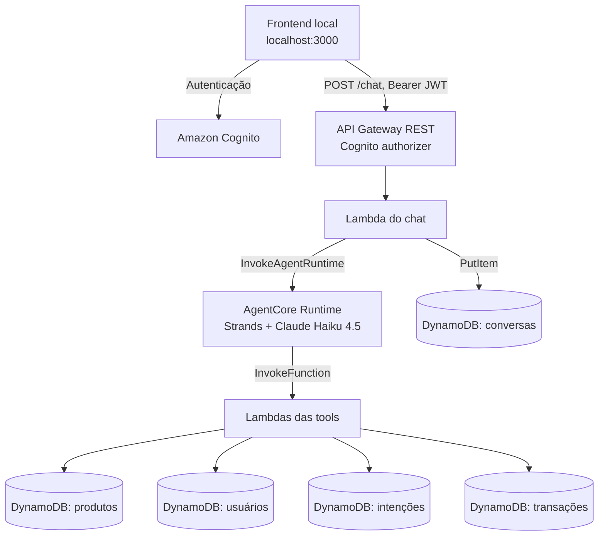

# Desafio 1 — Alan Lorenz

## Status da entrega

Infraestrutura AWS (backend, autenticação e dados) implantada em `us-east-1`
(stack `AlanLorenzInfraStack`) e frontend Next.js executado localmente em
`http://localhost:3000`. Login Cognito, endpoint de chat protegido com streaming,
agente Strands no Bedrock AgentCore Runtime (Claude Haiku), as três ferramentas
em Lambda e fluxo de compra (catálogo, intenção e pagamento simulado) foram
validados com recursos reais. Evidências anonimizadas estão em
[`evidências/`](./evidências/).

**Frontend local (adaptação):** a stack não provisiona S3/CloudFront; o frontend
é configurado por `.env.local` com os outputs do deploy e executado localmente
conforme [`frontend/README.md`](./frontend/README.md). Manter a aplicação
funcional e o usuário do instrutor disponível até a correção, e remover os
recursos após a avaliação (ver [Remoção](#remoção-da-infraestrutura)).

## Arquitetura



O endpoint de chat exige autenticação Cognito. O `userId` é sempre o `sub`
validado no token (nunca valor enviado pelo cliente/modelo). A API transmite
respostas em streaming.

## Modelo

`us.anthropic.claude-haiku-4-5-20251001-v1:0` (perfil de inferência do Amazon
Bedrock, `us-east-1`). A invocação real do modelo pode gerar custos e depende
de acesso habilitado na conta.

## Modelagem DynamoDB

| Tabela | Chave de partição | Chave de ordenação | Conteúdo |
|---|---|---|---|
| `AlanLorenz-Produtos` | `id` | — | Catálogo, preço em centavos, estoque e categoria |
| `AlanLorenz-Usuarios` | `userId` (`sub`) | — | Limite total e saldo restante em centavos; perfil criado/garantido no primeiro acesso autenticado ao chat (limite inicial R$ 1.000,00 / 100000 centavos) |
| `AlanLorenz-Conversas` | `userId` (`sub`) | `messageKey` | Mensagens e eventos de ferramentas por conversa/turno (chave determinística para idempotência) |
| `AlanLorenz-Intencoes` | `intentionId` | — | Usuário, conversa, total calculado, status e expiração (5 minutos) |
| `AlanLorenz-Transacoes` | `intentionId` | — | Transação simulada; uma por intenção (evita duplicidade) |

Cobrança sob demanda com limite de throughput configurado (5 RCU/WCU por tabela;
não é teto de gasto mensal). Sem TTL/índices secundários. A compra atualiza
intenção, limite, estoque e transação em escrita condicional/transacional.

**Limitação conhecida:** mensagens são persistidas e o histórico do turno é
enviado ao agente, mas não há endpoint para restaurar conversas salvas após
recarregar a página.

## Revisão de permissões IAM

Roles de aplicação separadas por função, sem `AdministratorAccess`. Permissões
DynamoDB/serviços limitadas aos ARNs/recursos necessários.

| Role | Permissões principais |
|---|---|
| `AlanLorenz-ChatHandler` | Logs no próprio log group; `bedrock-agentcore:InvokeAgentRuntime` no runtime; `dynamodb:PutItem` em `AlanLorenz-Conversas`; `dynamodb:GetItem`/`PutItem` em `AlanLorenz-Usuarios` (provisionamento idempotente do perfil) |
| `AlanLorenz-ListCatalog` | `dynamodb:Scan` em `AlanLorenz-Produtos`; logs no próprio log group |
| `AlanLorenz-RegisterIntention` | `GetItem` em Produtos; `GetItem`/`PutItem` em Usuários; `PutItem` em Intenções; logs no próprio log group |
| `AlanLorenz-RealizarCompra` | `GetItem`/`UpdateItem`/`TransactWriteItems` em Intenções e Produtos; `GetItem`/`UpdateItem`/`TransactWriteItems` em Usuários; `PutItem`/`TransactWriteItems` em Transações; logs no próprio log group |
| `ChatAgentRuntimeExecutionRole` | Invoca somente as 3 Lambdas de tools; acesso ao perfil de inferência e foundation models correspondentes (condicionado ao perfil); permissões operacionais/telemetria do AgentCore |

Grants globais `Resource: "*"` de X-Ray/métricas do AgentCore foram removidos
(há teste CDK que falha se reaparecerem). Permanecem padrões `*` delimitados em
permissões operacionais geradas pelo AgentCore (logs/identidade/invocação,
restritos a região/conta), não grants globais de dados. Acesso ao Haiku restrito
ao perfil e destinos regionais do perfil US. Role de deploy é separada das roles
de runtime; não armazenar credenciais no repositório.

## Deploy e provisionamento

Pré-requisitos: Node.js/npm, Python 3.13, `uv`, AWS CLI configurada, acesso ao
modelo Bedrock em `us-east-1` e autorização para criar recursos/custos.

### Validar e implantar (PowerShell, pasta `infra/`)

```powershell
npm ci
npm run test -- --runInBand
npm run test:agent
npm run synth
# após revisar o template e com autorização:
npm run deploy
```

`npm run deploy` faz bootstrap (se necessário) e publica `AlanLorenzInfraStack`
(backend, Cognito, API, AgentCore, Lambdas, DynamoDB) — não publica frontend.
Anote outputs: `UserPoolId`, `UserPoolClientId`, `ChatApiEndpoint`, `AgentRuntimeArn`.

Validações adicionais: `frontend/` → `npm ci && npm run check`; `tools/` →
`npm ci && npm run check`.

### Seed do catálogo (após deploy autorizado, pasta `tools/`)

```powershell
$env:AWS_PROFILE = "desafio-1"
$env:PRODUCTS_TABLE = "AlanLorenz-Produtos"
npm run seed:catalog
```

### Criar usuários por convite (Cognito, sem auto cadastro)

Usar o `UserPoolId` do output. O usuário recebe senha temporária e define nova
senha no primeiro login.

```powershell
$env:AWS_PROFILE = "desafio-1"
$poolId = "<UserPoolId>"
$email  = "<email-do-usuario-ou-instrutor>"

aws cognito-idp admin-create-user `
  --user-pool-id $poolId `
  --username $email `
  --user-attributes Name=email,Value=$email Name=email_verified,Value=true `
  --desired-delivery-mediums EMAIL `
  --region us-east-1
```

Se o e-mail não chegar, é possível suprimir envio e definir senha temporária
(não compartilhar valores): `--message-action SUPPRESS --temporary-password "<SenhaTemporaria>"`.
Verificar status: `aws cognito-idp admin-get-user --user-pool-id $poolId --username $email --region us-east-1`.

**Usuário do instrutor:** criar por convite com o e-mail informado pela
coordenação, manter disponível até a correção e garantir que a aplicação/stack
permaneça acessível para avaliação (o frontend é local; alinhar com a
coordenação o formato de acesso/demonstração, se necessário).

### Frontend local

Em `frontend/`, criar `.env.local` com:

```env
NEXT_PUBLIC_USER_POOL_ID=<UserPoolId>
NEXT_PUBLIC_USER_POOL_CLIENT_ID=<UserPoolClientId>
NEXT_PUBLIC_CHAT_API_URL=<ChatApiEndpoint>
```

Executar `npm ci && npm run dev` e acessar `http://localhost:3000`. Após
alterar `.env.local`, reiniciar o servidor.

## Evidências de validação

Capturas/registros anonimizados (sem JWT, senhas ou dados pessoais):

| Cenário exigido | Estado | Evidência |
|---|---|---|
| Login Cognito | Validado | [login-cognito.png](./evidências/login-cognito.png) |
| `401` sem token válido | Validado | [401-sem-token.png](./evidências/401-sem-token.png) |
| Compra simulada com cartão | Validado | [realizar-compra-cartao.png](./evidências/realizar-compra-cartao.png) |
| Compra simulada com Pix | Validado | [realizar-compra-pix.png](./evidências/realizar-compra-pix.png) |
| Compra recusada por limite excedido | Validado | [limite-excedido.png](./evidências/limite-excedido.png) |
| `intencao_id` inválido / não autorizado | Validado | [intencao-invalida.png](./evidências/intencao-invalida.png) |

Complementares (fluxo das tools): [listar-catalogo.png](./evidências/listar-catalogo.png),
[registrar-intencao.png](./evidências/registrar-intencao.png).

## Remoção da infraestrutura

Após a correção/avaliação e com autorização:

```powershell
cd infra
npm run cdk -- destroy AlanLorenzInfraStack
```

Apaga tabelas/DynamoDB, usuários do Cognito, API, Lambdas e AgentCore da stack
(fazer backup se necessário). O bootstrap CDK compartilhado da conta/região não
é removido por esse comando; confirmar no console que não restaram recursos.

## Pastas

- [`frontend/`](./frontend/) — interface local e autenticação Cognito.
- [`api/`](./api/) — Lambda de chat, provisionamento idempotente do usuário e persistência de conversas.
- [`agent/`](./agent/) — agente Strands executado no AgentCore.
- [`tools/`](./tools/) — ferramentas de catálogo, intenção e compra.
- [`infra/`](./infra/) — stack AWS CDK e validações de infraestrutura.
- [`evidências/`](./evidências/) — registros anonimizados dos cenários validados.
